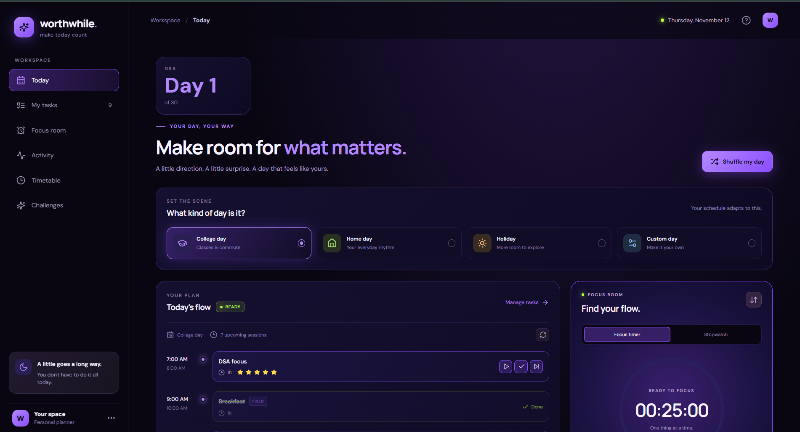
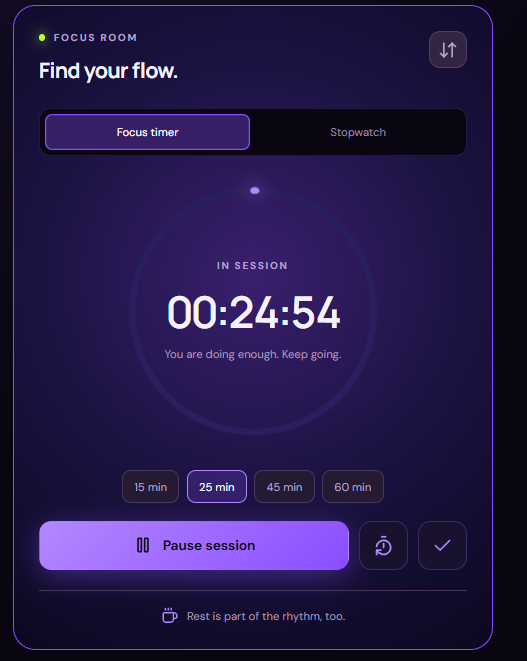
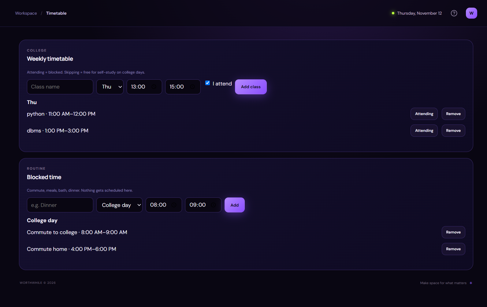

Worthwhile 💜

A study planner that shuffles your day without breaking your priorities. Your commitments stay fixed, your priorities stay meaningful, and your flexible sessions keep changing.

**Live demo:** YOUR-LIVE-LINK



## Why I built it

Most timetable apps give you the same rigid routine every day. I wanted a planner that keeps my commitments protected but varies the order of my study sessions, so the day stays interesting without ignoring exams or priorities.

## Features

- **Day types:** college, home, holiday, and custom days, each with its own schedule
- **Smart shuffle:** flexible sessions are reordered every time, while fixed commitments never move
- **Star priorities (0-5):** higher-priority tasks are placed first
- **Exam boost:** a task's priority rises automatically as its exam date approaches
- **Task splitting:** splittable tasks (like DSA) break into chunks, and non-splittable ones always get one continuous slot
- **Missed-session recovery:** a missed starred session replaces a strictly lower-priority upcoming session, with a clear explanation
- **College timetable:** mark each class as attending (blocked) or skipping (free for self-study)
- **Blocked time:** commute, meals and routines that the scheduler never uses
- **Challenge counter:** "Day 28 of 60" counting up or down
- **Focus room:** timer and stopwatch based on real timestamps, not just a counter
- **Activity heatmap:** a calendar of completed sessions, with no streaks or points




## How the scheduler works

The scheduling engine lives in `lib/scheduler.ts` as a pure TypeScript module, separate from the UI, so it can be tested on its own.

1. Load the tasks allowed on the selected day type
2. Place fixed commitments first
3. Shuffle the remaining tasks, then sort by effective priority (stars plus exam boost)
4. Place each task into the first free slot that respects its allowed time window, blocked time and splitting rules
5. Report anything that could not be placed instead of overlapping sessions

## Tech stack

Next.js 15, React, TypeScript, plain CSS, Vitest. Data is stored in the browser with localStorage.

## Tests

The scheduler has automated tests covering blocked time, overlaps, exam boosts, task splitting and every recovery rule.

```bash
npm test
```

## Run it locally

```bash
git clone https://github.com/ritecha/worthwhile.git
cd worthwhile
npm install
npm run dev
```

Then open http://localhost:3000.

## Known limitations and next steps

- Data is saved per browser, so there is no cloud sync yet
- Refreshing during a focus session resets the timer
- A recovered session that is only partly recovered shows a carry-forward message, but the remainder is not yet scheduled on the next day
- Possible next steps: accounts and cloud storage, timetable import, installable mobile app
